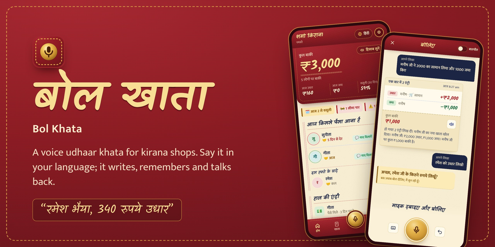
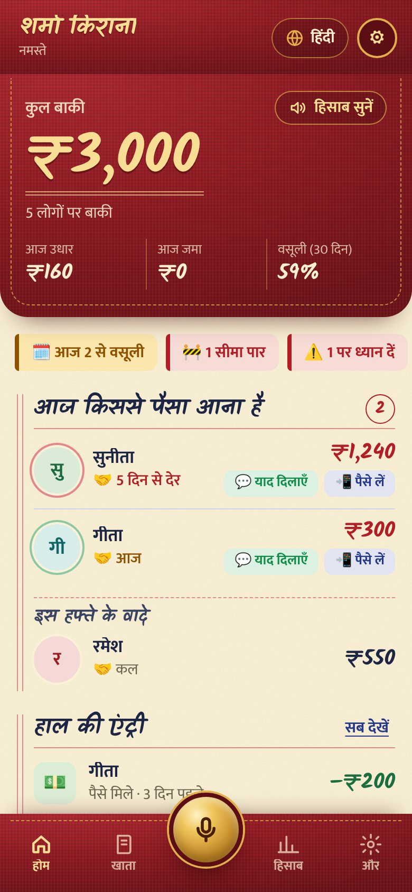
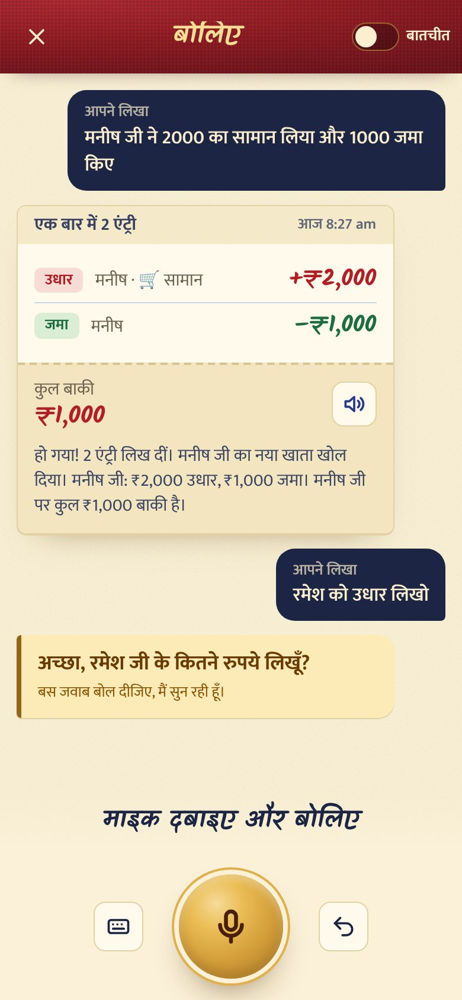
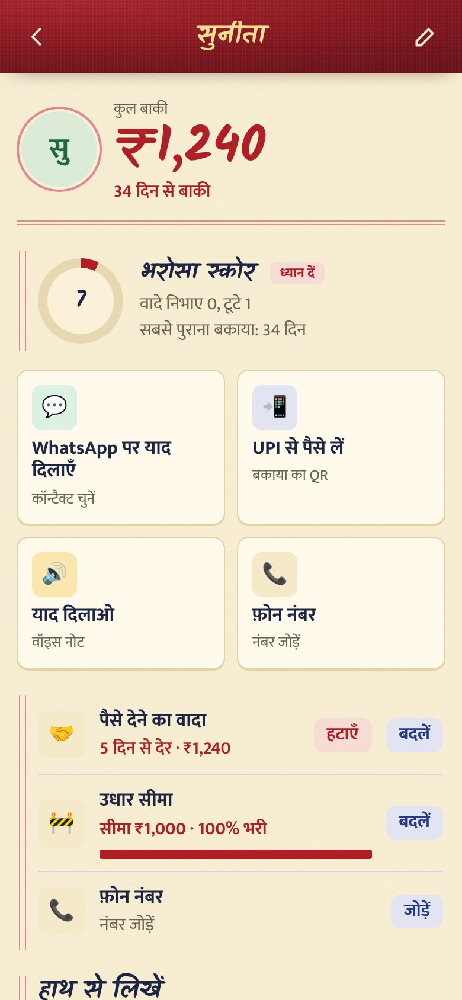
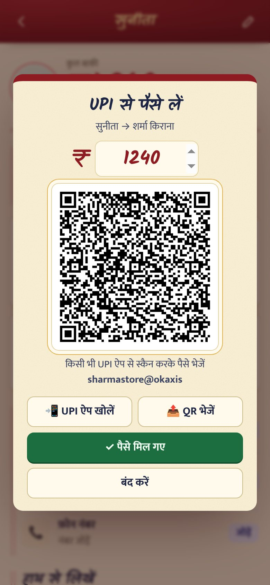
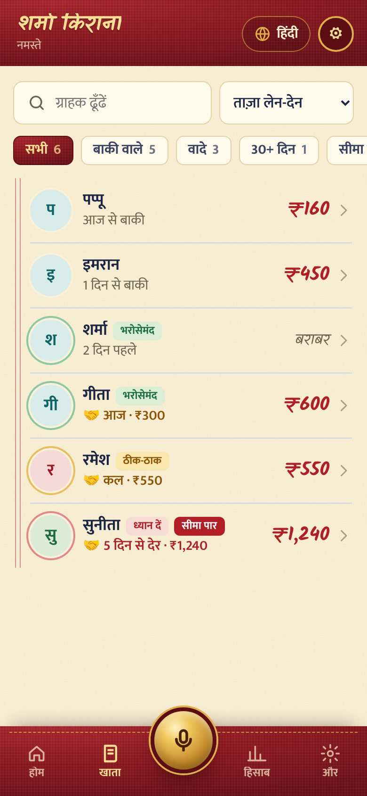
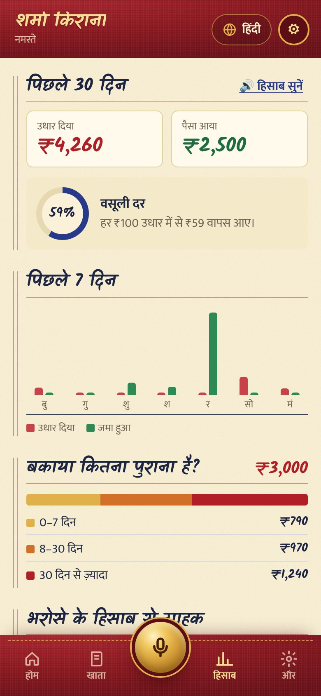
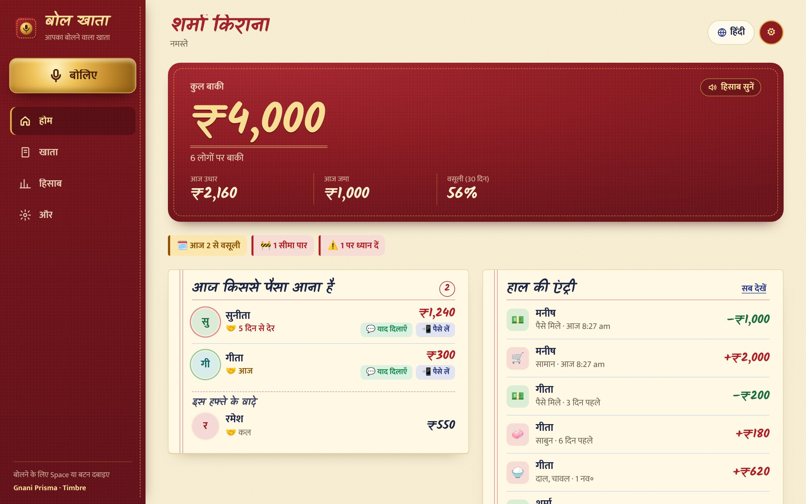
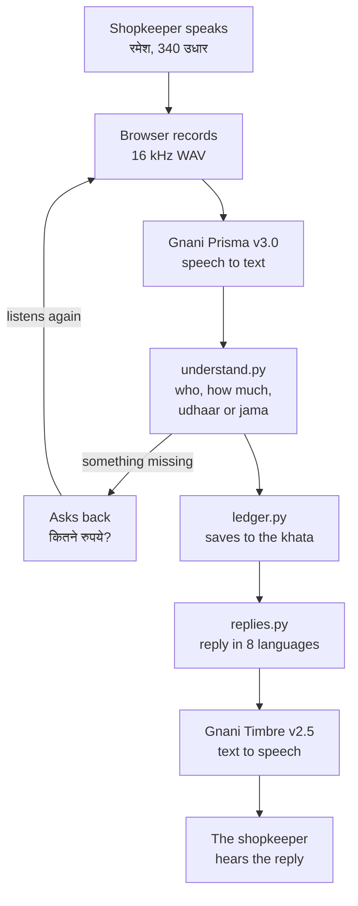

<p align="center">
  
</p>

<h1 align="center">बोल खाता · Bol Khata</h1>

<p align="center">
  <b>A khata you just talk to.</b> The shopkeeper says the udhaar out loud, in their own language.<br>
  Bol Khata writes it down, remembers who owes what, and answers back in a real voice.
</p>

<p align="center">
  
  
  
  
  
</p>

<p align="center">
  <a href="#see-it">See it</a> ·
  <a href="#what-it-does">What it does</a> ·
  <a href="#how-it-works">How it works</a> ·
  <a href="#run-it-on-your-laptop">Run it</a> ·
  <a href="#put-it-online-vercel">Put it online</a>
</p>

<!-- Add your links here when you have them:
<p align="center"><a href="https://YOUR-APP.vercel.app"><b>Try the live demo</b></a> · <a href="https://YOUR-VIDEO-LINK"><b>Watch the 3-minute demo</b></a></p>
-->

---

## Why

Most kirana shops in India still keep udhaar in a red cloth notebook, the *bahi-khata*. In the evening rush
there's no time to write every entry. Pages get lost, totals are added by hand, and a wrong total can cost a customer.
Khata apps exist, but they want typing, often in English, from someone with a queue at the counter.

Bol Khata keeps the notebook the shopkeeper already trusts, and takes away the writing. You say it the way you'd
say it to a helper, and it's written.

## A conversation with Bol Khata

| You say | Bol Khata writes it, and says back |
|---|---|
| मनीष जी ने 2000 का सामान लिया और 1000 जमा करके गए<br><sub>Manish took goods for 2,000 and paid 1,000</sub> | हो गया! 2 एंट्री लिख दीं। मनीष जी का नया खाता खोल दिया। मनीष जी पर कुल ₹1,000 बाकी है।<br><sub>Done, two entries. Opened a new khata for Manish. He owes ₹1,000 in total.</sub> |
| रमेश को उधार लिखो<br><sub>Write udhaar for Ramesh</sub> | अच्छा, रमेश जी के कितने रुपये लिखूँ?<br><sub>Okay, how much for Ramesh?</sub> *(and it listens again by itself)* |
| तीन सौ<br><sub>Three hundred</sub> | हो गया, रमेश जी का ₹300 उधार लिख लिया।<br><sub>Done, ₹300 udhaar written for Ramesh.</sub> |
| रमेश शुक्रवार को 500 देगा<br><sub>Ramesh will pay 500 on Friday</sub> | नोट कर लिया, रमेश जी शुक्रवार को ₹500 देंगे। मैं याद रखूँगी।<br><sub>Noted, Ramesh pays ₹500 on Friday. I'll remember.</sub> |
| सुनीता 300 का सामान ले गई<br><sub>Sunita took goods for 300</sub> | …ध्यान दें: सुनीता जी की सीमा ₹1,000 है, पर उधार अब ₹1,540 हो गया है।<br><sub>…Careful: Sunita's limit is ₹1,000, but she now owes ₹1,540.</sub> |
| गलत है<br><sub>That's wrong</sub> | पिछली एंट्री हटा दी: सुनीता जी, ₹300 उधार।<br><sub>Removed the last entry: Sunita, ₹300 udhaar.</sub> |

The replies are spoken by Gnani Timbre, and they're worded a little differently each time, so it sounds like a
person at the counter and not a recording.

## See it

<table>
  <tr>
    <td align="center" width="25%"><br><sub><b>Home.</b> The cloth cover shows the total due; below, who should pay today.</sub></td>
    <td align="center" width="25%"><br><sub><b>Speak.</b> Two entries from one sentence, and a question back when the amount is missing.</sub></td>
    <td align="center" width="25%"><br><sub><b>A customer.</b> Trust score, promise, limit, WhatsApp and UPI.</sub></td>
    <td align="center" width="25%"><br><sub><b>Collect.</b> A UPI QR for the exact amount due.</sub></td>
  </tr>
  <tr>
    <td align="center"><br><sub><b>Khata.</b> Every customer, with filters for promises, 30+ days and over limit.</sub></td>
    <td align="center"><br><sub><b>Hisaab.</b> Money back from every ₹100 given, and how old each due is.</sub></td>
    <td align="center" colspan="2"><br><sub><b>On a laptop.</b> The cover becomes a sidebar, and each section is its own ledger sheet.</sub></td>
  </tr>
</table>

All names and numbers in the screenshots are made up (the app's sample customers).

## What it does

### The parts that make it different

| | What happens |
|---|---|
| **It talks back** | If the amount, the name or the date is missing, it asks ("कितने रुपये?"), listens again on its own, and saves when you answer. |
| **Two things in one sentence** | "2000 का सामान लिया और 1000 जमा किए" becomes two entries. Remarks like "अब 1000 बाकी है" aren't saved as extra entries. |
| **Promises to pay** | "रमेश शुक्रवार को 500 देगा" is saved with its date. Home shows who should pay today, late promises turn red, and it tells you when someone keeps their word. |
| **Trust score** | A 0–100 score for each customer, from how fast they repay, how old their due is, and promises kept or missed. Shown as a coloured ring: भरोसेमंद, ठीक-ठाक, ध्यान दें. |
| **Credit limits** | "सुनीता की लिमिट 1000 रखो". When new udhaar crosses it, the slip turns red and the voice warns you. |
| **Collect by UPI** | A QR for the exact due, using your shop's UPI ID. Tap *पैसे मिल गए* when the money arrives. |
| **Fix it by voice** | "गलत है" removes the last entry. "रमेश 500 नहीं 400 उधार" corrects it in one go. |
| **Hands-free mode** | Turn on *बातचीत* and it keeps listening after every reply. Say "बस" to stop. |
| **Feels like their own khata** | Red cloth cover with gold stitching, ruled pages, handwritten amounts (red ink for udhaar, green for jama), and a brass mic. |

### Everyday basics

- **Udhaar:** "रमेश, 340 रुपये उधार" · "Pappu ko 160 ka doodh bread diya" · "सीता 600 का सामान लेकर गई"
- **Jama:** "Sharma ji ne 500 jama kiye" · "इमरान से 200 मिले"
- **Questions:** "सुनीता का कितना बाकी है?" · "आज का हिसाब बताओ" · "आज किससे पैसा आना है?"
- **Indian amounts:** "साढ़े तीन सौ" (350), "dedh sau" (150), "1 लाख 20 हज़ार". Timbre reads amounts back in words.
- **Reminders:** a polite WhatsApp message (with your UPI ID), or a voice note in Timbre's voice.
- **8 languages:** English, हिंदी, मराठी, ગુજરાતી, বাংলা, தமிழ், తెలుగు, ಕನ್ನಡ. The screens, the spoken replies, the language
  Prisma listens for, and even customer names (रमेश → Ramesh → ரமேஷ்) switch together.
- **Gmail sign-in:** every shopkeeper gets their own private khata, shop name and UPI ID.
- **By hand too:** quick udhaar/jama form, phone number, rename, CSV download, and *saved khatas* to start fresh
  without losing anything.

## How it works



1. **Hear.** The browser records your voice and stops after 2.5 seconds of quiet, so a pause mid-sentence is fine.
   The server sends it to **Gnani Prisma** (`/stt/v3`) with a kirana-khata topic and your customer names as
   keyterms, so it hears "Imran" and "Pappu" correctly.
2. **Understand.** `understand.py` finds who, how much, udhaar or jama, items, promises, limits and corrections.
   A sentence with two amounts is split into two entries. If something is missing, the server sends back a question.
   An optional LLM (smart mode) handles long, messy sentences; the built-in rules work without one.
3. **Write.** `ledger.py` saves the entry in SQLite, one separate file per signed-in account, and updates
   promises, limits and the trust score.
4. **Speak.** `replies.py` writes the reply twice: with ₹ digits for the screen, and with numbers as words for the
   voice. **Gnani Timbre** (`/api/v1/tts/inference`) speaks it with a matching voice for each language
   (Nalini for Hindi, Kaveri for English, Asmita for Tamil…). Replies are cached, so the same sentence never costs
   credits twice.

Your Gnani key stays on the server. The browser never sees it.

## Run it on your laptop

You need a laptop with a microphone, Chrome or Edge, internet, and a Gnani API key.

**1. Install Python** (one time). Download Python 3.12 from [python.org](https://www.python.org/downloads/).
On the first installer screen, tick **Add python.exe to PATH**.

**2. Get a Gnani API key.** Sign in at [app.gnani.ai](https://app.gnani.ai), open the
[voice dashboard](https://app.gnani.ai/voice), and create a key in **API keys**. Keep it private.

**3. Download and start.**

```bash
git clone https://github.com/khushiiii24/BOL_KHATA.git
cd BOL_KHATA
```

- **Windows:** double-click `start.bat`. The first time, it installs what it needs and opens a `.env` file in
  Notepad. Paste your key after `GNANI_API_KEY=`, save, and close Notepad.
- **Mac or Linux:** run `./start.sh`, then put your key in `.env` the same way.

Your browser opens [localhost:8000](http://localhost:8000). Allow the microphone when it asks.

**4. Try it.** Open **और** and tap **नमूना ग्राहक भरें** to load made-up customers. Then tap the brass mic (or press
**Space**) and say *"रमेश भैया, दो किलो आटा, 340 रुपये उधार"*. No mic? Tap the keyboard button and type instead.

### Optional extras

- **Smart mode:** get a free key at [console.groq.com](https://console.groq.com) and set `LLM_API_KEY` in `.env`.
  Recommended for Marathi, Gujarati, Bengali, Tamil, Telugu and Kannada beyond the common sentences.
- **Gmail sign-in** (each shopkeeper gets their own khata): about 10 minutes, one time.
  Follow [GOOGLE_LOGIN_SETUP.md](GOOGLE_LOGIN_SETUP.md), then set `GOOGLE_CLIENT_ID` in `.env`.

## Put it online (Vercel)

The screens and the server deploy together as one app, with one link.

```bash
npm install -g vercel
vercel login
vercel          # first deploy, answer the questions
vercel --prod   # after adding the settings below
```

In the Vercel project, open **Settings → Environment Variables** and add `GNANI_API_KEY`, a long random
`SESSION_SECRET`, and `PUBLIC_URL` (your `https://….vercel.app` address). For Gmail sign-in, also add
`GOOGLE_CLIENT_ID`, and add the Vercel address to the client's **Authorized JavaScript origins** in Google Cloud.

> [!NOTE]
> Vercel can't keep SQLite files, so online the khata lives in a temporary folder that Vercel clears from time to
> time. That's fine for a demo (load the sample customers), not for a real shop. For data that stays, run it on
> your own machine or a server with a disk.

## Settings

All settings live in `.env` (copied from `.env.example` on first start).

| Setting | What it does | Default |
|---|---|---|
| `GNANI_API_KEY` | Your Gnani key (**required**) | — |
| `SHOP_NAME` | Shop name in reminders while sign-in is off | `Sharma General Store` |
| `STT_MODEL` / `TTS_MODEL` | Gnani models | `prisma-v3.0` / `timbre-v2.5` |
| `TTS_VOICE_HI`, `_EN`, `_MR`, `_GU`, `_BN`, `_TA`, `_TE`, `_KN` | Timbre voice per language | Nalini, Kaveri, Zahira, Falak, Kirra, Asmita, Lavanya, Saanvi |
| `LLM_API_KEY` | Turns on smart mode | empty |
| `GOOGLE_CLIENT_ID` | Turns on Gmail sign-in, one khata per Gmail | empty |
| `ALLOWED_EMAILS` | Only these Gmails may sign up (comma-separated) | empty (anyone) |
| `PUBLIC_URL` | Your https address, when online | empty |
| `SESSION_SECRET` | Signs the sign-in cookie, when online | made automatically on a laptop |

## If something goes wrong

| You see | Do this |
|---|---|
| "Gnani API key नहीं मिली" | Put your key after `GNANI_API_KEY=` in `.env`, save, and run `start.bat` again. |
| Gnani error 401 | The key is wrong. Copy it again from app.gnani.ai, with no spaces. |
| Gnani error 402 | Your credits may be used up. Check app.gnani.ai. |
| "माइक की इजाज़त नहीं मिली" | Click the lock or mic icon in the address bar, allow the microphone, reload. |
| Wrong name or amount | Say "गलत है" and say it again, a bit slower. Smart mode helps with long sentences. |
| Old design or old features | Close the black start.bat window, run it again, and press Ctrl+Shift+R. |
| Google: `origin_mismatch` | The **Authorized JavaScript origins** must match the address exactly, such as `http://localhost:8000`. |

## Project layout

```
BOL_KHATA/
├─ start.bat / start.sh      double-click (Windows) or run (Mac, Linux)
├─ .env.example              settings template
├─ app/                      the server (FastAPI)
│  ├─ main.py                routes and the flow: hear → understand → write → reply
│  ├─ gnani.py               Gnani Prisma (speech to text) and Timbre (text to speech)
│  ├─ understand.py          who, how much, udhaar or jama, promises, limits, corrections
│  ├─ numbers.py             Indian number words: "साढ़े तीन सौ" ⇄ 350, lakh, crore
│  ├─ replies.py, phrases.py what Bol Khata says, in 8 languages
│  ├─ translit.py            names in each script: रमेश → Ramesh → ரமேஷ்
│  ├─ ledger.py              the khata: entries, promises, limits, trust score (SQLite)
│  └─ auth.py, accounts.py   Gmail sign-in, one private khata per account
├─ static/                   the app's screens (HTML, CSS, JavaScript, fonts)
├─ tests/                    python -m pytest -q
├─ docs/                     banner, screenshots, contest notes
└─ vercel.json, pyproject.toml   for deploying on Vercel
```

Run the tests with `python -m pytest -q` (141 tests: the parser in all 8 languages, multi-entry sentences,
talk-back, promises, limits, trust score and separate accounts).

## Privacy

- **Made-up data only** in demos and screenshots. The sample customers are fictional.
- With sign-in on, each account's khata is a **separate file**, chosen on every request from a signed, HTTP-only cookie.
  Requests without a signed-in account can't read any khata.
- The Gnani and LLM keys stay on the server and are never sent to the browser.
- On a laptop, the app only listens on `localhost`, so other devices on the Wi-Fi can't open it.

## Credits

- Built for the **Great Indian AI Internship Challenge** by [Gnani AI](https://gnani.ai), on Gnani **Prisma** (speech to text)
  and **Timbre** (text to speech).
- Fonts: [Kalam](https://fonts.google.com/specimen/Kalam), [Mukta](https://fonts.google.com/specimen/Mukta) and
  [Baloo 2](https://fonts.google.com/specimen/Baloo+2) (with its Bengali, Gujarati, Kannada, Tamil and Telugu
  versions), all under the SIL Open Font License, bundled in `static/fonts`.
- QR codes: [qrcode-generator](https://github.com/kazuhikoarase/qrcode-generator) by Kazuhiko Arase (MIT).
- Server: [FastAPI](https://fastapi.tiangolo.com).

Made by [khushiiii24](https://github.com/khushiiii24).